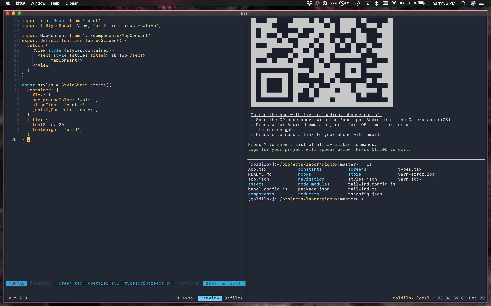
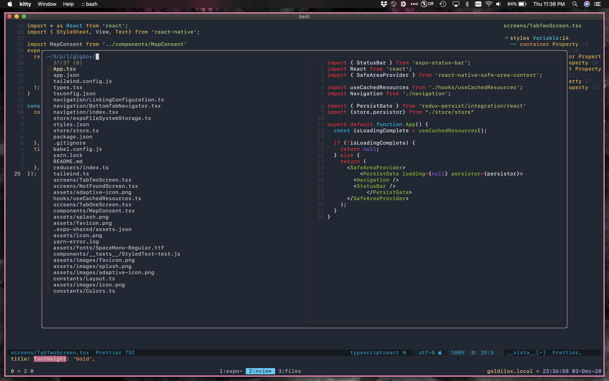

# ellipsis

... very okay dotfiles

## Setting up a new Mac

```sh
xcode-select --install          # if you don't already have it
git clone git@github.com:dcalacci/ellipsis.git ~/attic/ellipsis
cd ~/attic/ellipsis
./setup.sh --all
```

If you don't have SSH access to GitHub yet, clone over HTTPS, run
`./setup.sh --ssh` first to generate a key, then `gh auth login` and
`git remote set-url origin git@github.com:dcalacci/ellipsis.git`.

`setup.sh` is safe to re-run. Anything already in place is skipped, and real
files sitting where a symlink should go get moved to
`~/.ellipsis-backup/<timestamp>/` rather than deleted. `--dry-run` prints what
it would do and touches nothing.

### Steps

Run with no flags for an interactive prompt, or pick steps:

| flag | what it does |
| --- | --- |
| `--all` | brew core+work+media, dotfiles, shell, nvim, languages, ssh |
| `--brew core,work` | just those Brewfile tiers |
| `--dotfiles` | symlinks only |
| `--shell` | zinit + tpm |
| `--nvim` | sync the LazyVim plugin set |
| `--langs` | nvm/node, rustup, pipx tools, miniforge, git-lfs |
| `--ssh` | generate a per-machine ed25519 key and write `~/.ssh/config` |
| `--macos` | system defaults (keyboard repeat, trackpad, Finder, Dock, screenshots) |
| `--keyboard` | swap Caps Lock and Control |
| `--wm` | yabai + skhd and their configs |
| `--dry-run` | combine with any of the above |

### Package tiers

Brewfiles live in `brew/` and are plain `brew bundle` input, so you can run any
of them by hand:

- **core** — shell, CLI, terminal, fonts, browsers, the Proton suite, Tailscale.
  Everything needed before the machine is usable.
- **work** — research and writing: Obsidian, Zotero, R/RStudio, Quarto, MacTeX,
  Linear, Slack, Zoom, Office, Docker, the editors, the language toolchains.
- **media** — rekordbox, Ableton, Audacity, OBS, VLC, and desk utilities.
- **heavy** — Adobe CC, Android Studio, Cura, XQuartz. ~20GB. Opt in.
- **wm** — yabai and skhd. Needs SIP partially disabled to be fully useful.

Things brew can't install, printed again at the end of a run: OneTagger,
Lexicon, and the Mac App Store apps (Magnet, Bear, Goodnotes — use `mas`).

### Machine state that isn't dotfiles

Most of a working machine isn't config files. `macos/capture-state.sh`, run on
the **old** machine, dumps the replayable parts into `state/`:

| file | what |
| --- | --- |
| `Brewfile.actual` | full `brew bundle dump`, to diff against the curated tiers |
| `r-packages.txt` | every non-base R package, with the R version it came from |
| `vscode-extensions.txt` | VS Code extension ids |
| `mas-apps.txt` | Mac App Store app ids |
| `git-repos.txt` | checkout paths and their origin remotes |
| `ssh-hosts.txt` | host alias names only, no keys |
| `crontab.txt`, `launchagents.txt` | informational, deliberately not replayed |

Commit that, then on the new machine run `macos/restore-state.sh` (interactive,
or `--r --editors --mas --repos --all`). It will not touch cron or LaunchAgents:
those are per-machine, and two hosts running the same unison sync jobs will
fight over the same Proton Drive folders.

## What's in here

### neovim

LazyVim, configured in `nvim/`, symlinked to `~/.config/nvim`.

This replaced LunarVim in October 2026. LunarVim's last meaningful release was
May 2024, it only runs against neovim 0.9.x, and it has no active maintainers.
The old config is still in `lvim/` for reference but nothing installs it.

The port keeps what the lvim config actually did:

- `<space>` leader, kanagawa colorscheme, format on save
- `<leader>R` for iron.nvim REPL send — R, Rmd, Quarto, Python, shell
- `<leader>A` for asynctasks (`AsyncTask render` on an Rmd)
- jupytext so `.ipynb` files open as Rmd
- Copilot, plus the LazyVim Claude Code extra
- R support via R.nvim, with `R_pdfviewer` set to open in Preview
- fugitive, diffview, octo, aerial, trouble, zen-mode (`<leader>&`, was Goyo)
- ruff instead of the old black + flake8 pair

### kitty

`kitty/kitty.conf`, symlinked to `~/.config/kitty`. Font is **BlexMono NF**
(IBM Plex Mono Nerd Font), which `Brewfile.core` installs — if the terminal
renders in a fallback font, check `kitty +list-fonts | grep -i blex`.

### zsh

zinit for plugins, with a hand-rolled prompt in `zsh/prompt.zsh`. The old
`setup.sh` also installed oh-my-zsh and oh-my-git, neither of which `zshrc`
ever sourced; that's gone.

Machine-specific settings that shouldn't be committed go in `~/.zshrc.local`,
which `zshrc` sources last if it exists.

### tmux

`tmux/tmux.conf`, prefix is `C-]`. Plugins are managed by tpm, which
`setup.sh --shell` clones to `~/.tmux/plugins/tpm`. Press `prefix + I` inside
tmux the first time to fetch them.

### keyboard

`macos/keyboard-remap.sh` swaps Caps Lock and Control, replicating the mapping
already running on muriel (Caps Lock becomes Right Control; both Controls
become Caps Lock). macOS keys this per keyboard by vendor-product id, which is
why a new machine doesn't inherit it. The script writes entries for every
keyboard currently attached plus the ids already known from muriel's externals.
`--show` prints the current state, `--reset` removes it. Takes effect at next
login. If it misbehaves, `karabiner-elements` is in brew and works lower down.

`macos/KeyBindings/DefaultKeyBinding.dict` adds the Emacs bindings macOS
doesn't ship: `M-f`/`M-b` word motion, `M-d` and `C-w` word kill, `C-u` kill to
line start, `M-<`/`M->` document ends, `M-c`/`M-u`/`M-l` case, `C-g` cancel.
The ones macOS already has (`C-a` `C-e` `C-k` `C-y` `C-n` `C-p` `C-d` `C-t`)
aren't repeated. This only reaches native Cocoa text views, so Slack, Discord,
VS Code, Obsidian, and Firefox are unaffected; the terminal is already covered
by `bindkey -e` in `zsh/keybindings.zsh`. Binding Option as Meta costs you the
Option-key glyphs on those letters.

### tiling window manager

[yabai](https://github.com/koekeishiya/yabai) plus
[skhd](https://github.com/koekeishiya/skhd) for keybindings, configured in
`wm/`. Opt-in via `--wm`, since yabai's space-manipulation features need SIP
partially disabled.

## screenshots




